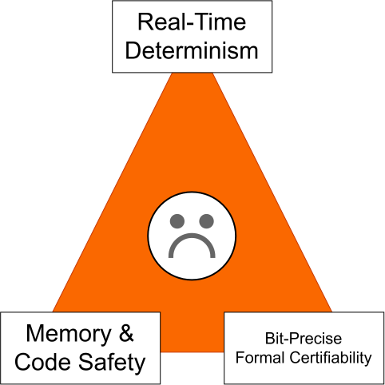

# Rusty-Soar

Rusty-Soar is a Rust port of [Soar](https://soar.eecs.umich.edu/), the cognitive architecture from
the University of Michigan. It has two goals:

- **Behave exactly like Soar.** It follows the C++ Soar kernel algorithm for algorithm, so research
  results carry over.
- **Be provable.** The kernel is safe, `no_std` Rust with fixed-size memory, so that tools like
  [Kani](https://model-checking.github.io/kani/) can prove properties about agents.



> [!WARNING]
> Rusty-Soar is in active development. The core decision cycle, reinforcement learning and most
> of semantic and episodic memory are ported, with a first version of chunking; the formal proofs
> are in progress. See [What's Ported](docs/reference/status.md).

## Quick start

You need [Rust](https://rustup.rs/). Then:

```bash
git clone https://github.com/Suave101/Rusty-Soar.git
cd Rusty-Soar/rusty-soar
cargo test --workspace
cargo run -p rusty-soar-cli -- trace ../differential/agents/count.soar
```

The last command runs a small agent that counts to five and prints its decisions in the same
format as C++ Soar.

## Documentation

The full documentation is in [`docs/`](docs/index.md), and builds into a website with MkDocs:

| Start here | |
|---|---|
| [Getting Started](docs/getting-started/index.md) | Install, run an agent, and connect one to your program |
| [Soar in Ten Minutes](docs/guides/soar-basics.md) | The ideas behind Soar, for newcomers |
| [What's Ported](docs/reference/status.md) | What works today and what doesn't yet |
| [Differences from C++ Soar](docs/reference/differences.md) | Every known difference, and why |

To read it as a website locally:

```bash
pip install -r docs/requirements.txt
mkdocs serve
```

## Repository layout

| Folder | What it holds |
|---|---|
| `rusty-soar/crates/rusty-soar-core` | The Soar kernel, as a `no_std` Rust library |
| `rusty-soar/crates/rusty-soar-cli` | Command-line tool for running agents |
| `rusty-soar/crates/formal-soar-verify` | Kani proof harnesses |
| `differential/` | Tools and test agents for comparing Rusty-Soar with C++ Soar |
| `docs/` | Documentation |

## License

Licensed under either of:

- [Apache License 2.0](https://www.apache.org/licenses/LICENSE-2.0)
- [MIT License](https://opensource.org/licenses/MIT)
